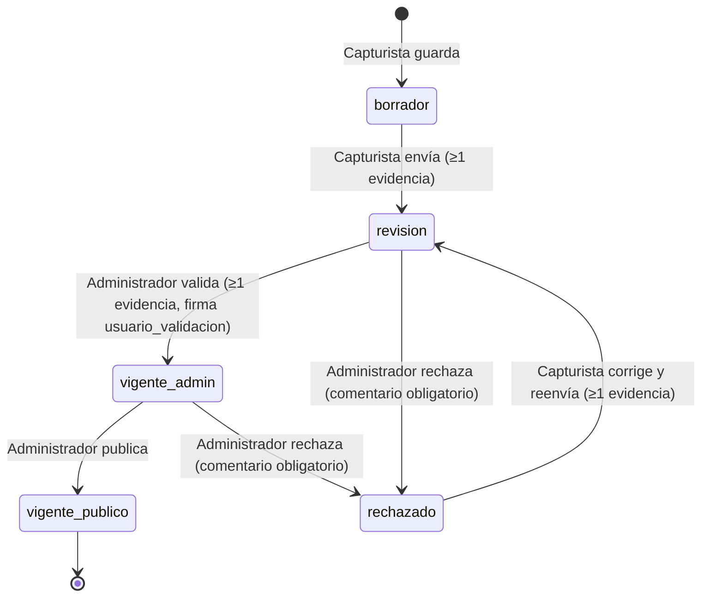

# SESIM · Front alineado a la arquitectura de datos v2.2

**Fecha:** 20 de octubre de 2026
**Repositorio:** `SESIM_Frontend` (React 19 + Vite 8 + Leaflet)
**Fuentes que dictan el cambio:**

- `Arquitectura_Datos_SESIM.docx` (arquitectura lógica MACRO/MESO/MICRO/TRANSVERSAL, diccionario de 19 tablas, 26 relaciones, IDs cortos, 16 funciones derivadas).
- Dataset oficial v4: `CARTOGRAFIA/EEMSV_CAMPECHE/09_BASE_DATOS_SESIM` (`geojson/`, `tablas/SESIM_operativo.xlsx`, `tablas/SESIM_tablas.xlsx`).

Este documento conecta la lógica del front con la infraestructura del backend que se está construyendo (PostgreSQL 16 + PostGIS 3.4, esquemas `core`/`api`, PostgREST, servicio de procesos). Para cada pieza de interfaz dice **qué tabla o función del modelo consume, cómo lo resuelve hoy el front y qué endpoint debe exponer el backend** para sustituir la solución temporal sin tocar componentes.

---

## 1. Resumen de cambios

| # | Cambio | Antes | Ahora |
|---|---|---|---|
| 1 | Capas del geovisor | 81 capas en `public/Datos/` (≈2 GB, nombres por archivo, atributos de origen, 5 archivos > 100 MB) | 87 capas + 2 de unidad territorial en `public/sesim/capas/<id_capa>.geojson` (157 MB en total, ninguna > 35 MB), identificadas con el ID corto del modelo |
| 2 | Catálogo de capas | Tres manifiestos escritos para el visor (`MapaBase`, `Diagnostico`, `Eje_N`) | Tabla `capa` exportada tal cual (`public/sesim/catalogo/capa.json`) |
| 3 | Catálogos del modelo | `Indicadores.csv` (14 columnas, sin llaves) y `catalogos_sesim.json` inventado | 12 tablas del modelo en JSON con los mismos nombres de tabla y columna que la base |
| 4 | Simbología | Por nombre de archivo, reglas sobre atributos de origen | Por `id_capa`, clasificada por `clasif`; paleta generada cuando el `.qml` no cubre las clases |
| 5 | Perfiles | `capturista`, `administradora`, `auditora` por contraseña; sin `Administrador Titular` | Perfiles canónicos de la tabla `perfil`: Capturista, Administrador, Administrador Titular, Auditor |
| 6 | Capturista | Subía cartografía e instrumentos | Captura **mediciones** con evidencia (Tabla 3 del documento) |
| 7 | Administrador | Dictaminaba capas e instrumentos simulados | Valida, rechaza con comentario y publica mediciones (F10); carga capas; revisa las 14 capas en borrador; tablero F04/F05/F09 |
| 8 | Administrador Titular | No existía | Invitaciones con token de un solo uso (F16) y bajas de usuario |
| 9 | Auditor | Línea de tiempo fija | Historial real desde la bitácora (F12), verificación SHA-256 de evidencias (F11), hallazgos |
| 10 | Bitácora | `BitacoraLogs.jsx` con datos simulados | Bitácora generada por cada cambio, con columnas del diccionario y visibilidad por perfil |
| 11 | Monitoreo | Tabla plana del CSV | Ficha por indicador: F01, F15, F06 («Ver en el geovisor»), F02 + F04 |

---

## 2. Mapa del modelo en el front

```
MACRO · Gobernanza        eje_tematico · sector · fuente_informacion · instrumento_origen
                          matriz_instrumento · indicador_instrumento
        └─ Monitoreo (ficha F01/F15), filtros del tablero del Administrador, CapaCargaModal

MESO · Indicadores        indicador · periodo · unidad_territorial(_geom) · medicion_indicador
        └─ MedicionModal (captura), DetalleMedicion, DashboardKPIs, coropleta F05, Monitoreo F02/F04

MICRO · Geoespacial       capa · capa_vector (GeoJSON por capa) · capa_indicador
        └─ Geovisor (árbol desde `capa`, ficha F07/F08, deep-link F06)

TRANSVERSAL               perfil · usuario · invitacion · bitacora · evidencia_medicion (+ hallazgo)
        └─ Sesión/perfiles, F10, evidencias SHA-256 (F11), invitaciones (F16), BitacoraPagina
```

| Bloque | Tabla | Archivo / módulo del front que la consume |
|---|---|---|
| MACRO | `eje_tematico`, `sector`, `fuente_informacion` | `pages/MonitoreoIndicadores.jsx`, `AdministradorLayout.jsx` (filtros) |
| MACRO | `instrumento_origen`, `indicador_instrumento`, `matriz_instrumento` | `lib/sesim/api.js` → `fnTrazabilidadNormativa`, `vEquivalenciaPimus`, `vCoberturaInstrumento` |
| MESO | `indicador` | Monitoreo, `MedicionModal`, `DetalleMedicion`, tablero |
| MESO | `unidad_territorial` (+ `_geom`) | Selector municipio → localidad (jerarquía `id_padre`), `MapaPerfil` (polígonos municipales) |
| MESO | `periodo`, `medicion_indicador` | `lib/sesim/operacion.js` (temporal, ver §8) |
| MICRO | `capa`, `capa_indicador` | `lib/sesim/capas.js`, `components/geovisor/*` |
| MICRO | `capa_vector` | `public/sesim/capas/<id>.geojson` → `CapaSesim.jsx` |
| TRANSVERSAL | `perfil`, `usuario`, `invitacion`, `bitacora`, `evidencia_medicion` | `lib/sesim/sesion.js`, `lib/sesim/operacion.js`, perfiles y `BitacoraPagina.jsx` |

---

## 3. Capa de datos del front (`src/lib/sesim/`)

| Módulo | Responsabilidad |
|---|---|
| `api.js` | **Único punto de lectura del modelo.** `tabla(nombre)` lee `public/sesim/catalogo/<tabla>.json`; si existe `VITE_SESIM_API_URL`, lee `GET {API}/<tabla>` (PostgREST). Incluye las funciones derivadas de lectura (F01, F06, F07, F08, F14, F15) y la carga de GeoJSON por capa. |
| `capas.js` | Construye el árbol del geovisor desde `capa` y decide visibilidad por `estatus`. |
| `simbologia.js` | Decide la simbología de cada capa (QGIS / categórica / única). |
| `sesion.js` | Perfiles canónicos, matriz de permisos (Tabla 3), sesión simulada. |
| `operacion.js` | Tablas que se llenan en operación y sus reglas (F10, F11, F16, hallazgos, bitácora). **Sustituto temporal del backend.** |
| `semaforo.js` | F04 `fn_semaforo`, réplica exacta de la función SQL del documento. |
| `useCatalogo.js` | Hook para leer varias tablas. |

### 3.1 Contrato de los JSON de catálogo

`public/sesim/catalogo/` contiene una fila por registro con **los nombres de columna del diccionario** (sección 2 del documento). Generado por `scripts/datos/01_exportar_catalogos.py` desde `SESIM_operativo.xlsx`.

| Archivo | Filas | Llave | Notas |
|---|---:|---|---|
| `perfil.json` | 4 | `id` 1–4 | Capturista, Auditor, Administrador, Administrador Titular |
| `eje_tematico.json` | 5 | `id` | |
| `sector.json` | 31 | `id` (`SD-xx`, `SO-xx`) | `tipo` viene vacío en el libro operativo |
| `fuente_informacion.json` | 17 | `id` | |
| `instrumento_origen.json` | 6 | `id` (`Eemsv01`, `PimusCal01`…) | `id_unidad_ambito` liga cada PIMUS a su municipio (R06) |
| `matriz_instrumento.json` | 135 | `id` (`PimusCar01R07`) | |
| `indicador_instrumento.json` | 205 | `id` | `correspondencia` = origen / directa / parcial |
| `indicador.json` | 113 | `id` (`Im01`, `Ee05`, `Accgir01`) | Booleanos SMART convertidos desde fórmulas `=TRUE()` |
| `unidad_territorial.json` | 2,785 | `id` (CVEGEO) | 13 municipios + 2,772 localidades, con `id_padre` |
| `capa.json` | 87 | `id` (`Inf09`, `DIt01`, `E2Tpp05`…) | Ver §3.2 |
| `capa_indicador.json` | 1,030 | (`id_capa`, `id_indicador`) | |
| `v_capa_por_municipio.json` | 737 | (`id_capa`, `id_unidad`) | F08 precalculada (hoja `cruce_capa_municipio`); `id_unidad = null` = fuera de Campeche |
| `indice.json` | — | — | Fecha de generación, origen y conteos |

### 3.2 Columnas de `capa.json`

Columnas del diccionario: `id`, `uuid_legado`, `titulo`, `proposito`, `tipo_geometria`, `estatus`, `responsable`, `conjunto_datos`, `id_instrumento`, `archivo`, `grupos`, `nomenclatura`, `n_elementos`, `geojson`, `metadatos_extra{contacto_custodio, fuente_origen, linaje, escala_nominal, denominador_escala, sistema_coordenadas, fecha_corte, periodicidad, restriccion_uso}`.

Columnas **auxiliares de lectura** (no se almacenan en la base; las agrega el exportador para el front):

| Columna | Qué es | Equivalente en backend |
|---|---|---|
| `categoria` | `mapa_base` · `diagnostico` · `estrategia` | Derivable de `grupos` o columna propia en la vista |
| `geom` | `point` · `line` · `polygon` | `tipo_geometria` traducido |
| `grupos_lista` | `grupos` separado en `[{categoria, grupo}]` | Vista `api.v_capa_visor` |
| `clases` | Valores distintos de `clasif` en la capa (máx. 60) | `SELECT DISTINCT propiedades->>'clasif' FROM capa_vector WHERE id_capa = …` |

Decisiones al exportar (documentadas también en el script):

- `estatus` y `proposito` no vienen en el libro operativo: se toman de `SESIM_tablas.xlsx` (hoja `capa`) cruzando por `uuid_legado`. Resultado: 73 `vigente_publico`, 14 `borrador`.
- `id_instrumento` = `Eemsv01` para las 55 capas de Diagnóstico y Estrategia; `null` para Mapa Base (R05).

### 3.3 Cambiar a backend

1. Exponer en PostgREST las tablas/vistas de §3.1 con los mismos nombres en el esquema `api`.
2. Definir `VITE_SESIM_API_URL=https://<servidor>/api` en `.env`.
3. Sustituir, función por función, el cálculo local de `api.js` por la llamada RPC o la vista (tabla de §4). Los componentes no cambian porque reciben la misma forma de datos.
4. Sustituir `operacion.js` por llamadas a la API (ver §8). Es el único módulo con escritura.

---

## 4. Funciones derivadas → front

| ID | Función / vista | Dónde se usa | Implementación temporal | Endpoint esperado |
|---|---|---|---|---|
| F01 | `fn_trazabilidad_normativa` | Monitoreo → ficha | `api.fnTrazabilidadNormativa()` (join en el cliente) | `POST /rpc/fn_trazabilidad_normativa {p_id_indicador}` |
| F02 | `v_serie_indicador` | Monitoreo → serie publicada | `operacion.vSerieIndicador()` | `GET /v_serie_indicador?id_indicador=eq.Im18` |
| F03 | `fn_tasa_por_poblacion` | *Pendiente en interfaz* | — (`pob_tot` ya está en `unidad_territorial.json`) | `POST /rpc/fn_tasa_por_poblacion` |
| F04 | `fn_semaforo` | Monitoreo, DetalleMedicion, tablero | `semaforo.fnSemaforo()` — misma lógica que el SQL de §7.2 | `POST /rpc/fn_semaforo` o columna de `v_coropleta_indicador` |
| F05 | `v_coropleta_indicador` | Tablero del Administrador (mapa) | Calculada en `AdministradorLayout.generar()` | `GET /v_coropleta_indicador?id_indicador=eq.…&id_periodo=eq.…` |
| F06 | `fn_capas_de_indicador` | Monitoreo «Ver en el geovisor», tablero «Ver capas», `/geovisor?indicador=` | `api.fnCapasDeIndicador()` | `POST /rpc/fn_capas_de_indicador` |
| F07 | `fn_indicadores_de_capa` | Ficha de capa (geovisor) | `api.fnIndicadoresDeCapa()` | `POST /rpc/fn_indicadores_de_capa` |
| F08 | `v_capa_por_municipio` | Ficha de capa → «Elementos por municipio» | `v_capa_por_municipio.json` | `GET /v_capa_por_municipio?id_capa=eq.Inf09` (agregar km y km²) |
| F09 | `fn_completitud_captura` | Tablero del Administrador | `operacion.fnCompletitudCaptura()` | `POST /rpc/fn_completitud_captura` |
| F10 | `fn_transicion_estado` | Capturista (enviar), Administrador (validar / rechazar / publicar) | `operacion.fnTransicionEstado()` | `POST /rpc/fn_transicion_estado {p_id_medicion, p_estado, p_comentario}` |
| F11 | `fn_verificar_evidencia` | Auditor → pestaña Evidencia | `operacion.fnVerificarEvidencia()` (SHA-256 en el navegador) | `POST /rpc/fn_verificar_evidencia` (el servidor recalcula sobre el archivo guardado) |
| F12 | `v_historial_registro` | DetalleMedicion → Historial | `operacion.vHistorialRegistro()` | `GET /v_historial_registro?tabla_afectada=eq.medicion_indicador&id_registro=eq.<uuid>` |
| F13 | `v_cubo_mediciones` | *Pendiente (OLAP / MCP)* | — | `GET /v_cubo_mediciones` |
| F14 | `v_cobertura_instrumento` | Disponible en `api.js` (aún sin pantalla) | `api.vCoberturaInstrumento()` | `GET /v_cobertura_instrumento` |
| F15 | `v_equivalencia_pimus` | Monitoreo, MedicionModal (capturista ve cómo lo mide su PIMUS), DetalleMedicion | `api.vEquivalenciaPimus()` | `GET /v_equivalencia_pimus?id_indicador=eq.Im18` |
| F16 | `fn_emitir_invitacion` | Panel «Usuarios e invitaciones» (solo Titular) | `operacion.fnEmitirInvitacion()` | `POST /rpc/fn_emitir_invitacion` + canje en el registro |

---

## 5. Capas GeoJSON (`public/sesim/capas/`)

### 5.1 Origen y nombre

> La carpeta es `public/sesim/` y no `public/datos/`: en Windows `datos` y `Datos` son la misma carpeta, y la anterior `public/Datos/` se mezclaba con la nueva.

- Origen: `09_BASE_DATOS_SESIM/geojson/` (capas higienizadas, una por capa, encabezado con `id_capa`).
- Nombre del archivo = **ID corto de la capa**: `Inf09.geojson`, `DIt06.geojson`, `E4SegVial07.geojson`. Es la misma llave de `capa.id`, `capa_indicador.id_capa` y `capa_vector.id_capa`, y la misma que usan las rutas del geovisor (`/geovisor?capa=Inf09`).
- Unidad territorial: `public/sesim/capas/unidad_territorial/municipios.geojson` y `localidades.geojson` (`properties.id` = CVEGEO, `clasif` = nivel).

### 5.2 Esquema de cada archivo

```json
{
  "type": "FeatureCollection",
  "id_capa": "E4SegVial07",
  "uuid_legado": "789c9e65-…",
  "titulo": "Estrategias Eje 4 (representadas como puntos)",
  "categoria": "estrategia",
  "n_elementos": 48,
  "features": [{
    "type": "Feature",
    "geometry": { "type": "Point", "coordinates": [-90.0558, 20.37467] },
    "properties": {
      "id": "d0134679-…",      // capa_vector.id (UUID)
      "nombre": "Adecuación geométrica…",
      "clasif": "Adecuación geométrica…",   // clase de simbología
      "cve_mun": "001",
      "id_unidad": "04001"      // unidad_territorial.id; null fuera de Campeche
    }
  }]
}
```

Se conservan **todas las llaves que relacionan la capa con el modelo** (encabezado = fila de `capa`; `id` = `capa_vector.id`; `cve_mun`/`id_unidad` = Ruta 5 territorial) y **todos los elementos** (`n_elementos` del archivo = `n_elementos` de la tabla en las 89 capas; verificado por el script). `id_unidad` se agrega como `'04' + cve_mun` (nivel municipio); el nivel localidad de `capa_vector.id_unidad` no viene en los GeoJSON de origen.

### 5.3 Cómo se aligeraron

Script: `scripts/datos/02_aligerar_capas.py` (usa `mapshaper`).

| Parámetro | Valor | Efecto |
|---|---|---|
| Precisión | 5 decimales | ≈ 1.1 m en Campeche |
| Simplificación | Douglas-Peucker, resolución inicial 5 m, `keep-shapes` | Ningún polígono ni línea desaparece |
| Escalamiento | Si la capa pasa de 5 MB se duplica la resolución (máx. 160 m), **salvo** que el ahorro sea < 15 %: en ese caso lo que pesa son los atributos y se conserva la geometría más detallada | No se sacrifica detalle a cambio de nada |
| Puntos | Sin simplificar | |
| Atributos | Sin cambios | Llaves intactas |

Resultado: **288 MB → 157 MB** en 89 archivos. 81 capas quedan por debajo de 5 MB; ninguna supera 35 MB, así que todas se pueden subir a GitHub sin LFS (límite duro de 100 MB, advertencia en 50 MB). La bitácora por capa (origen, tamaño final, resolución aplicada, conteo) queda en `scripts/datos/salida/aligerado.json`.

Capas que siguen pesando más de 5 MB, porque el peso está en los atributos (UUID + nombre + clase por elemento):

| Capa | Elementos | MB | Resolución |
|---|---:|---:|---|
| `DIt07` Vía de cuota (trazo Diagnóstico) | 118,001 | 34.1 | 5 m |
| `Inf11` Red carretera regional | 89,624 | 25.7 | 5 m |
| `DIt06` Recubrimiento de la red carretera (Diagnóstico) | 56,507 | 15.5 | 5 m |
| `Inf09` Recubrimiento de la red carretera (Mapa Base) | 56,507 | 15.4 | 5 m |
| `DIt04` Estado y calidad de la red urbana | 57,842 | 14.8 | 5 m |
| `Loc05` Manzanas (borrador) | 23,165 | 8.2 | 5 m |
| `Inf14` Eje de calle (borrador) | 17,751 | 5.6 | 5 m |
| `Inf10` Vía de cuota (Mapa Base) | 18,959 | 5.4 | 5 m |

**Recomendación para el backend:** servir estas 8 capas como teselas vectoriales (MVT) desde `capa_vector` con pg_tileserv/Martin (esquema `tiles`, ya previsto en la arquitectura). En el front solo cambia `api.geojsonDeCapa()`. Mientras tanto, el servidor web debe comprimir con gzip/brotli: un GeoJSON se reduce entre 5 y 8 veces en tránsito.

---

## 6. Simbología por `clasif`

El pipeline del dataset llenó `clasif` con la **etiqueta de la clase del `.qml`** de cada capa. Por eso `scripts/datos/01_exportar_catalogos.py` reescribe la simbología QGIS que ya usaba el visor (guardada en `scripts/datos/legado/`) para que clasifique por `clasif` y la publica en `public/sesim/simbologia.json` con llave `id_capa`. 58 de las 87 capas tienen simbología QGIS convertida.

`src/lib/sesim/simbologia.js` decide en el navegador:

1. **QGIS**: si la simbología cubre ≥ 50 % de los elementos con una clase con nombre, o es de símbolo único.
2. **Categórica**: si no, y la capa tiene de 2 a 12 clases, paleta cualitativa por `clasif` (paleta de agua y vegetación para la nomenclatura NAT; «Sin categoría» en gris).
3. **Única**: color por grupo o eje.

En los tres casos un elemento sin símbolo se dibuja con el estilo de respaldo: **ninguno se oculta**. El reporte de cobertura por capa está en `scripts/datos/salida/simbologia_reporte.json`. Usan paleta generada las capas cuyo `.qml` clasifica por otro campo (DIt06 e Inf09 —recubrimiento y jerarquía vial—, DIt07, DTts02 y Nat05) y las que no tienen `.qml` pero sí de 2 a 12 clases (p. ej. E4SegVial02, siniestralidad municipal). Cuando SEDUMOP entregue los `.qml` definitivos, se vuelve a correr el exportador.

---

## 7. Interfaz pública

### 7.1 Geovisor (`/geovisor`)

- Árbol generado desde `capa`: **Mapa Base** por nomenclatura (LIM, LOC, INF, NAT), **Diagnóstico** por subgrupo (`grupos`), **Estrategias** por eje. Una capa en dos grupos (DTp01, DIt05, DIt06, E2Tpp09) es una sola capa: se activa por `id`.
- **Visibilidad por estatus:** el público solo ve `vigente_publico` (73). Las 14 en `borrador` las revisa el Administrador.
- Siempre encendidas: `Lim03` (límite estatal) y `Lim04` (municipios, con etiqueta).
- Buscador por título, ID o conjunto de datos; chip con el ID de cada capa.
- **Ficha de capa:** metadatos ISO de `metadatos_extra`, instrumento de origen, **indicadores asociados (F07)** con liga al monitoreo, **elementos por municipio (F08)** y, si se abrió con clic, el elemento (`id`, `nombre`, `clasif`, unidad territorial).
- **Rutas:** `?estrategia=ejeN` (se conserva), `?capa=Inf09`, `?indicador=Im18` (F06, con aviso «Capas del indicador» y liga de regreso a la ficha).
- Descarga: entrega el GeoJSON real de cada capa activa (antes era un `.gpkg` de relleno).

### 7.2 Monitoreo (`/monitoreo`)

- Tabla de `indicador` con eje, sector, nivel MIR, tendencia, instrumentos (vía `indicador_instrumento`), número de capas (`capa_indicador`), semáforo de la última medición publicada y estatus de la ficha.
- Filtros: texto, eje, instrumento, nivel MIR, solo fichas aprobadas.
- Ficha (`?indicador=Im18`): variable, meta, tendencia, línea base, SMART, F01, F15, F06 y F02 con F04.

### 7.3 Página de inicio (`/`)

- Animaciones al desplazarse sin dependencias: `src/lib/useRevelar.js` (IntersectionObserver) marca con `revelado` los bloques con `data-revelar` (`arriba`, `izquierda`, `derecha`, `zoom`); el retraso escalonado va en la variable CSS `--retardo`. Barra de progreso de lectura y desvanecimiento del título al bajar.
- Cifras que cuentan hasta su valor real (`Contador.jsx`), leídas del catálogo: indicadores (`indicador`), capas publicadas (`capa.estatus = vigente_publico`), instrumentos (`instrumento_origen`) y municipios (`unidad_territorial`).
- Cada tarjeta de Estrategia muestra cuántas capas publicadas tiene su eje (grupo «Estrategia › Eje N» de `capa`).
- Clasificación: barras por nivel MIR calculadas de `indicador.nivel_mir` (Fin 12 · Propósito 59 · Componentes 35 · Actividades 7). Las insignias «34 Sectoriales / 39 Desempeño» siguen siendo texto fijo del diseño anterior y no corresponden al catálogo v2.2 (113 indicadores); falta definir con qué campo del modelo se calculan.
- Respeta `prefers-reduced-motion`: sin movimiento, todo visible.

---

## 8. Perfiles y flujo de una medición

### 8.1 Perfiles canónicos

| Clave en código | `perfil.id` | Pantalla | Escribe en | Lee |
|---|---:|---|---|---|
| `capturista` | 1 | `CapturistaLayout` | `medicion_indicador` (borrador), `evidencia_medicion` | Catálogos, sus mediciones, su bitácora |
| `auditor` | 2 | `AuditorLayout` | `hallazgo` | Todo (salvo borradores), bitácora completa |
| `administrador` | 3 | `AdministradorLayout` | Estado de `medicion_indicador`, `capa` | Todo (salvo borradores), bitácora completa |
| `administrador_titular` | 4 | `AdministradorLayout` + «Usuarios e invitaciones» | Lo anterior + `invitacion`, baja en `usuario` | Todo |

`sesion.perfilCanonico()` traduce los nombres heredados (`administradora`, `auditora`, `administrador_vip`). La matriz `PERMISOS` solo decide qué se muestra: **la autorización real será de RLS y de F10**.

### 8.2 Estados y transiciones (F10)



Reglas implementadas en `operacion.fnTransicionEstado()` y que **F10 debe replicar en la base**:

1. La transición debe existir en `TRANSICIONES` y el perfil debe estar autorizado.
2. El capturista solo mueve mediciones propias (`usuario_captura = auth.uid()`).
3. Se exige ≥ 1 `evidencia_medicion` para pasar a `revision` y a `vigente_admin` (R12).
4. `rechazado` exige comentario.
5. `vigente_admin` firma `usuario_validacion` y `fecha_validacion`; `rechazado` los limpia.
6. La primera publicación de un indicador sin línea base fija `linea_base`/`anio_linea_base` (F04, §7.2 del documento).
7. Cada cambio deja una fila en `bitacora` con `accion = 'cambio de estado'`, `datos_previos.estado`, `datos_nuevos.estado` y `datos_nuevos.comentario`.
8. Una cuenta dada de baja no puede escribir.

Otras reglas de escritura: la medición solo se edita en `borrador`/`rechazado` por su autor; llave única (`id_indicador`, `id_unidad`, `id_periodo`) (R09); `hash_archivo` único.

Visibilidad (Tabla 4): el borrador solo lo ve el capturista; desde `revision` lo ven administradores y auditor; `vigente_publico` lo ve cualquiera.

### 8.3 Pantallas

- **Capturista:** «Capturar medición» → indicador (buscador por ID, clave o nombre; muestra cómo lo mide **su** PIMUS, F15) → periodo (anual, semestral, trimestral o mensual; crea la fila de `periodo` si no existe) → municipio y localidad opcional (jerarquía `id_padre`; si su sesión tiene municipio, queda fijo) → valor numérico o cualitativo, desagregaciones (`jsonb`) → evidencia (SHA-256 calculado en el navegador). Bandeja por estado; las rechazadas muestran el motivo. El mapa resalta la unidad territorial.
- **Administrador:** bandeja (en revisión, validadas, publicadas, rechazadas) → detalle con ficha, evidencia e historial → Rechazar / Validar / Publicar. **Catálogo de capas:** carga de capa (`CapaCargaModal`: GeoJSON + ficha PDF + `.qml` opcional; propone el ID con la regla de la sección 4, valida el archivo en el navegador y lo previsualiza como borrador) y revisión de las 14 capas en borrador del dataset. **Tablero:** instrumento → eje → indicador → periodo → «Generar» (coropleta F05, semáforo F04, completitud F09), «Ver capas (F06)» y «Exportar CSV» con las columnas del diccionario.
- **Administrador Titular:** además, «Usuarios e invitaciones»: emite el token (se muestra una sola vez y se guarda solo su SHA-256, vence a los 7 días), lo revoca, y da de baja usuarios (`fecha_baja`, `id_usuario_baja`).
- **Auditor:** búsqueda y rango de fechas, historial de cada medición (F12), verificación de integridad (F11: el auditor carga el archivo y se compara su SHA-256 con `hash_archivo`) y registro de hallazgos con severidad.
- **Bitácora (`/bitacora`):** filtros por tabla, acción, fechas y texto; exportación JSON. El capturista ve solo sus eventos.

### 8.4 Inicio de sesión (simulado)

`/admin` → contraseña de prueba `administrador`, `titular` o `auditor` (cualquier otra entra como Capturista) y municipio opcional para el capturista. «Tengo una invitación» canjea un token emitido por el Titular: valida hash, caducidad y correo, marca `usada_en` y liga `id_usuario_creado`. Con Supabase Auth esto se sustituye por `signInWithPassword` y el perfil sale de `usuario.id_perfil` (decisión del 20 de octubre: usuarios en `auth.users`, sin `password_hash` propio).

---

## 9. Almacenamiento temporal: qué debe recibir el backend

Mientras no exista la API de escritura, `operacion.js` guarda en `localStorage` (clave `sesim_operacion_v2`) estas tablas, **con la forma del diccionario**:

| Tabla local | Columnas | Destino en backend |
|---|---|---|
| `periodo` | `id, anio, etiqueta, tipo_periodo, fecha_inicio, fecha_fin` | `core.periodo` (conviene precargarlo como catálogo) |
| `medicion_indicador` | `id, id_indicador, id_unidad, id_periodo, usuario_captura, usuario_validacion, valor, valor_texto, desagregaciones, estado, fecha_captura, fecha_validacion, created_at, updated_at` | `core.medicion_indicador` |
| `evidencia_medicion` | `id, id_medicion, id_usuario, url_archivo, tipo_documento, hash_archivo, fecha_subida` + `nombre_archivo`, `bytes` (lectura) | `core.evidencia_medicion` + Supabase Storage (`evidencias/<id_medicion>/<archivo>`) |
| `bitacora` | `id, id_usuario, tabla_afectada, id_registro, accion, datos_previos, datos_nuevos, ip_origen, fecha` + `perfil` (lectura) | `core.bitacora` (por disparadores) |
| `invitacion` | `id, token_hash, id_perfil, correo_destino, id_usuario_emisor, expira_en, usada_en, id_usuario_creado, revocada, created_at` | `core.invitacion` |
| `usuario` | `id, id_perfil, nombre, correo, activo, ultimo_acceso, created_at, updated_at, fecha_baja, id_usuario_baja` | `core.usuario` ligado a `auth.users` |
| `hallazgo` | `id, id_usuario, tabla_afectada, id_registro, descripcion, severidad, fecha` | `core.hallazgo` (**nueva**, ver §10) |
| `linea_base` | `{id_indicador: {linea_base, anio_linea_base, id_medicion}}` | `UPDATE core.indicador` |

Esto permite demostrar el flujo completo en un solo navegador (el capturista envía, cierra sesión, entra el administrador y valida), pero no comparte datos entre equipos. Es una solución de demostración, no de operación.

---

## 10. Pendientes y decisiones para el backend

1. **Comentario de dictamen:** el modelo v2.2 no tiene columna para el comentario obligatorio del rechazo; hoy viaja en `bitacora.datos_nuevos.comentario`. La tabla `dictamen` (acordada el 20 de octubre) debe recibirlo.
2. **Tabla `hallazgo`:** el documento dice que el auditor «registra hallazgos» pero no está en el diccionario de 19 tablas. El front ya la usa con la forma de §9.
3. **`periodo`** viene vacío en el dataset; el front crea periodos por etiqueta (`2026`, `2026-S1`, `2026-T3`, `2026-M07`). Conviene precargarlo como catálogo.
4. **`capa.estatus` y `capa.proposito`** no están en `SESIM_operativo.xlsx`; se tomaron de `SESIM_tablas.xlsx`. Igualarlos en ambos libros y en el control de cambios.
5. **`indice_geojson.csv`** trae rutas de una versión anterior (`03_siniestralidad`, `04_unidad_territorial`) y nombres con acento en otra codificación; el script localiza por `id_capa`.
6. **`capa_vector.id_unidad` a nivel localidad** y los atributos temáticos (jerarquía, carriles, siniestralidad…) no vienen en los GeoJSON; si el visor los necesita, exponerlos en la vista o en el MVT.
7. **`hash_archivo` UNIQUE** impide reutilizar un mismo documento en dos mediciones; si se aprueba la «evidencia reutilizable» (ciclo de soporte de capas), cambiar la regla en F10 y en el front.
8. **Mapa base:** el front sigue con Leaflet + Esri (sin clave). La arquitectura fijada es MapLibre GL JS con PMTiles propios (Esri queda descartado por el TDR §10.3 e). Cambiarlo es un ciclo aparte: el árbol, la simbología y la capa de datos ya están separados de Leaflet (`lib/sesim/*` es código puro).
9. **8 capas pesadas** → MVT (§5.3).
10. Los 14 **`.qml` pendientes** y las capas en borrador (corrección manual de metadatos) siguen abiertos en el dataset.
11. `papaparse` ya no se usa (el CSV se sustituyó por `indicador.json`); se puede quitar de `package.json`.

---

## 11. Archivos

### Nuevos

| Archivo | Qué hace |
|---|---|
| `src/lib/sesim/api.js`, `capas.js`, `simbologia.js`, `sesion.js`, `operacion.js`, `semaforo.js`, `useCatalogo.js` | Capa de datos (§3) |
| `src/components/geovisor/CapaSesim.jsx` | Dibuja una capa del catálogo |
| `src/components/perfiles/comun/*` | Bandeja, detalle de medición, mapa de perfil, estilos y utilidades compartidas |
| `src/components/perfiles/capturista/MedicionModal.jsx` | Captura de medición |
| `src/components/perfiles/administradora/CapaCargaModal.jsx` | Carga de capa (antes en el capturista) |
| `src/components/perfiles/administradora/InvitacionesPanel.jsx` | F16 y bajas |
| `src/pages/BitacoraPagina.jsx` | Bitácora por perfil |
| `public/sesim/catalogo/*.json`, `public/sesim/simbologia.json`, `public/sesim/capas/**` | Datos (§3.1, §5, §6) |
| `scripts/datos/01_exportar_catalogos.py`, `02_aligerar_capas.py`, `legado/`, `salida/` | Regeneración reproducible |
| `docs/FRONT_ARQUITECTURA_DATOS_V2.md` | Este documento |

### Modificados

`App.jsx` (rutas `/bitacora`; `/admin-control` y `/logs/*` redirigen), `MapViewer.jsx/.css`, `CapaMetadataModal.jsx`, `AdminMapViewer.jsx`, `Header.jsx`, `Administracion.jsx/.css`, `MonitoreoIndicadores.jsx/.css`, `ejesEstrategicos.js` (solo metadatos de los ejes), layouts y barras laterales de los tres perfiles, `PanelDictamen.jsx`, `DashboardKPIs.jsx`, `.gitignore`.

### Retirados (movidos a `_to_delete/`, fuera del repositorio)

`public/Datos/` (capas anteriores, ≈2 GB), `Datos/` (CSV duplicado), `src/lib/mapaBase.js`, `diagnostico.js`, `loaderCapas.js`, `capturista/CapturistaModal.jsx`, `capturista/InstrumentoModal.jsx`, `Bitacora/BitacoraLogs.jsx`, `plataforma/catalogos_sesim.json`. La carpeta `_to_delete/` está en `.gitignore`; bórrala cuando confirmes que todo funciona.

---

## 12. Regenerar y probar

```bash
# 1. Capas ligeras (requiere mapshaper: npm i -g mapshaper)
python3 scripts/datos/02_aligerar_capas.py ../CARTOGRAFIA/EEMSV_CAMPECHE/09_BASE_DATOS_SESIM
#    REHACER=1 para reprocesar todas (si no, reanuda por fragmentos)

# 2. Catálogos + simbología (requiere pandas y openpyxl)
python3 scripts/datos/01_exportar_catalogos.py ../CARTOGRAFIA/EEMSV_CAMPECHE/09_BASE_DATOS_SESIM

# 3. Front
npm install
npm run dev
```

Recorrido de prueba (verificado de punta a punta con un navegador automatizado):

1. `/admin` → correo cualquiera, contraseña cualquiera, municipio Carmen → **Capturar medición** → `Im18`, 2026, valor 120, adjuntar un PDF → Enviar a revisión.
2. Cerrar sesión → contraseña `administrador` → elegir la medición → Rechazar sin comentario (lo impide) → Validar → Publicar → en la barra inferior elegir `Im18` → Generar (coropleta y tablero).
3. Contraseña `auditor` → Evidencia → Verificar integridad con el mismo archivo (coincide) → registrar hallazgo.
4. Contraseña `titular` → Usuarios e invitaciones → generar token → cerrar sesión → «Tengo una invitación» con ese correo y token.
5. `/monitoreo?indicador=Im18` → serie publicada y semáforo; «Ver en el geovisor» → `/geovisor?indicador=Im18`.
